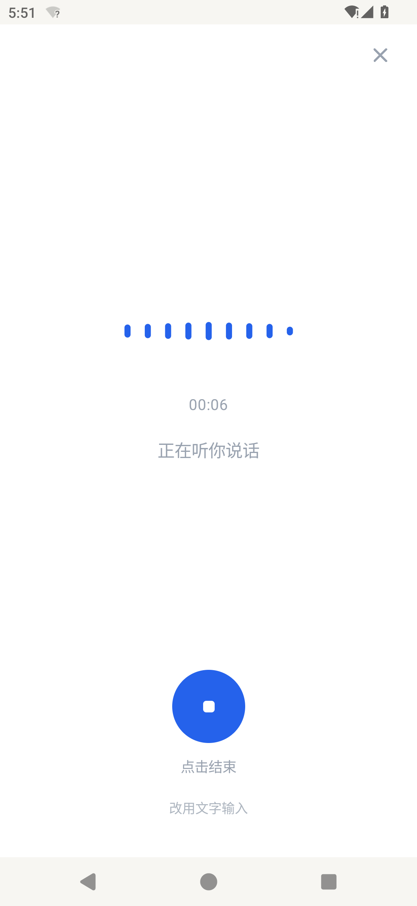
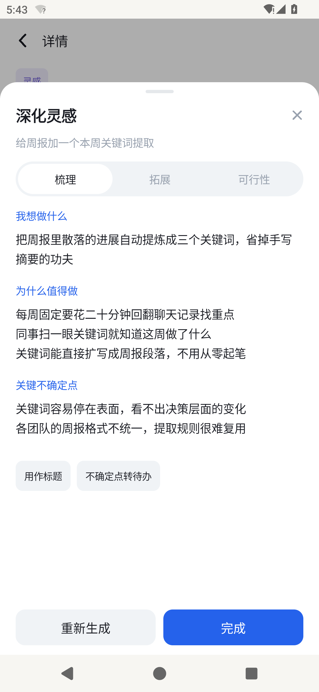
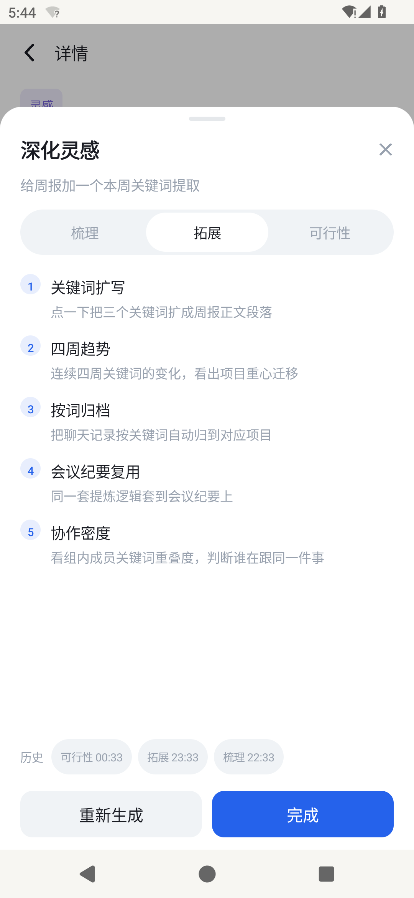
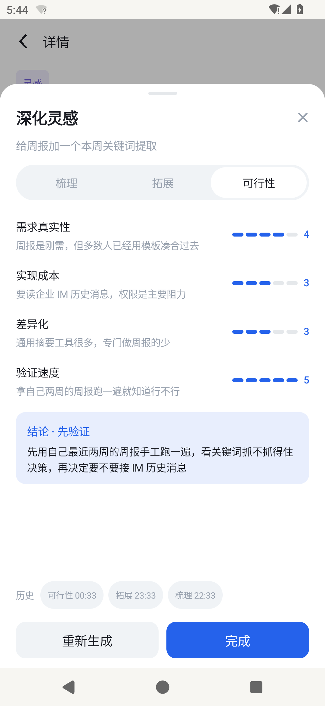
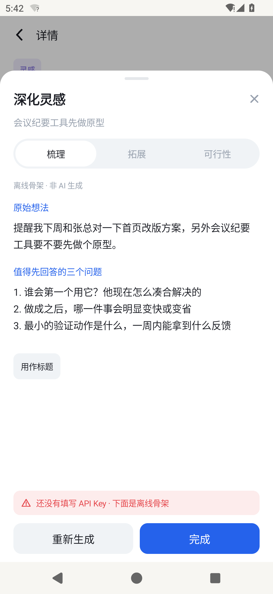
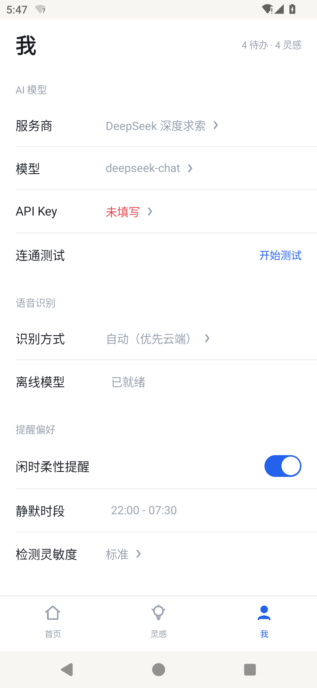
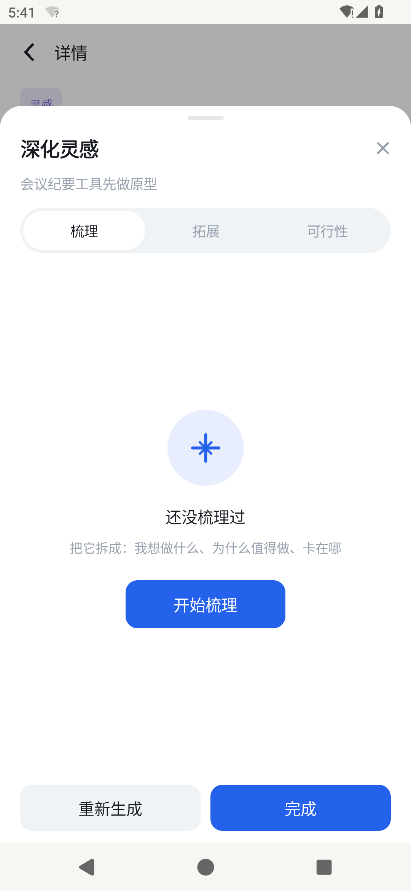

# v1.1.0 界面重设计 · 3.2 / 3.4 功能强化说明

> 对应两项要求：
> ① 参照《随记 SuiJi App UI》整体视觉风格与交互规范重做界面，各页面布局与组件风格与设计稿一致；
> ② 梳理并强化 3.2「AI 自动分拣」与 3.4「灵感深度辅助」，说明功能逻辑、改动页面、交互变化与旧版差异。
>
> 版本：1.1.0（versionCode 4）　构建：`app-release.apk`（arm64-v8a）　验证机：Android 14 / 1080×2340

---

## 0. 一页速览

| 要求 | 落点 | 证据 |
|---|---|---|
| 界面按稿重做 | 设计令牌化（1 组颜色 / 1 组圆角 / 1 组字号）+ 8 个页面全部重写 | `ui/Theme.kt`、`ui/Icons.kt`、`ui/Components.kt`、`docs/screenshots/01~13` |
| 3.2 强化 | 口语分段 → 规则预判 → 模型判定 → 置信度融合 → 三档处置 → 纠错回流 | `core/Segmenter.kt`、`core/Confidence.kt`、`core/Corrections.kt`、`net/Classifier.kt`、`ui/ReviewSheet.kt` |
| 3.4 强化 | 三模式结构化输出 + JSON 容错解析 + 离线骨架 + 结果反哺 | `core/InsightParser.kt`、`core/InsightSkeleton.kt`、`ui/InsightSheet.kt`、`data/MemoRepo.kt`(insight_version) |
| 可回归 | 45 项单元测试全绿（`app/src/test/`） | `gradle test` |

一句话概括这次改动的取向：**把「AI 说它懂了」变成「AI 说清它怎么想的，并且允许你当场推翻它」**。

---

## 1. 界面重设计

### 1.1 设计令牌：从稿子取样，不靠感觉

设计稿的视觉语言高度统一，但它本身不是可执行的规格。做法是先用 pymupdf 把 PDF 逐页渲染成位图，用 PIL 采样得到真实色值与尺寸，再固化成令牌——这样「和设计稿一致」是可验证的事实，而不是主观判断。

**颜色**（`ui/Theme.kt` → `SuiPalette`）

| 令牌 | 值 | 用途 |
|---|---|---|
| Primary | `#2562EB` | 主按钮、选中态、麦克风、录音乐章 |
| PrimarySoft | `#E8EEFD` | 药丸选中底、待确认横幅底、图标底 |
| Bg | `#FFFFFF` | 页面底色 |
| SoftBg | `#F0F3F6` | 输入块、分段控件槽、卡片 hover |
| SoftBg2 | `#F6F8FA` | 次级容器 |
| Line | `#E5E8EB` | 1px 分割线、卡片描边 |
| TextPrimary | `#1A1C23` | 标题、正文 |
| TextSecondary | `#99A2AF` | 元信息、占位、icon |
| Idea / IdeaSoft | `#6F5BD6` / `#EFECFC` | 灵感标签、灵感强调（与待办的蓝做区分） |
| Danger / DangerSoft | `#E5484D` / `#FDECEC` | 逾期、删除、错误条 |
| Success | `#12A150` | 已完成勾 |

**圆角**：标签 8 / 输入块 12 / 按钮 12 / 卡片 14 / 面板 22 / 药丸 26（全圆）。
**字号**：11（角标）/ 11.5（离线标记）/ 12.5（说明）/ 13.5（小标题）/ 15（正文）/ 17（录音字幕）/ 20（面板标题）/ 25（详情标题）/ 30（页面大标题）。
**间距**：页边距统一 20dp（`PagePad`），卡片间距 10dp，卡片内边距 18×16dp。

### 1.2 组件级规范

| 组件 | 规格 | 对应设计稿 |
|---|---|---|
| `MemoCard` | 14dp 圆角、`#E5E8EB` 描边、标题 15sp/Medium、元信息 13sp/Secondary、右侧动作区 42dp 见方 | p1、p7 |
| `PillSegmented` | 槽 `#F0F3F6` 圆角 26；选中项白底 + 主色文字 + 中等字重；`stretch=true` 时三等分（深化面板用） | p1、p5 |
| `MicDock` | 70dp 实心圆 + 98dp 径向渐隐光晕；`combinedClickable`：点击开录、长按转打字 | p1、p3、p7 |
| `SheetSurface` | 22dp 顶部圆角、90% 高、顶部 40×4dp 拖拽条 | p5 |
| `SettingRow` | 高 56dp、左标签右值、右箭头 12dp、组内 1px 分割 | p6 |
| `TypeTag` / `TagChip` | 待办蓝底 / 灵感紫底；标签胶囊灰底 8dp 圆角 | p1、p4 |
| `JudgmentCard` | 浅灰卡 `#F6F8FA`、左上「✦ AI 判定」、右上引擎名、置信度条、一句理由、三个动作按钮 | 新增（见 1.4） |

### 1.3 八屏对照

| 设计稿 | 设计稿内容 | 实现 | 差异 |
|---|---|---|---|
| p1 | 首页列表：随记 / 全部·待办·灵感 / 今天·3 / 卡片右侧「15:00」「深化」「✓」「逾期」/ 大麦克风 / 三 Tab | `ListPane` + `MicDock` + `BottomNav` | 标题行右侧**加了搜索图标**（原稿只有齿轮）；卡片右侧动作按语义分流为「确认 / 深化 / 圆圈 / 绿勾」 |
| p2 | 录音页：× / 波形 / 00:12 / 实时字幕 / 蓝圆白方 / 点击结束 / 改用文字输入 | `RecordingOverlay` | 一致；无字幕时该行显示「正在听你说话」，有字幕即被字幕顶替 |
| p3 | 新建记录：‹ 新建记录 完成 / 浅灰输入块 / 「AI 将自动分拣为待办或灵感」 | `CaptureScreen` | 一致；底部补了字数计与「完成」按钮的禁用态 |
| p4 | 详情：‹ 详情 / 待办胶囊 / 25sp 标题 / 🕐 今天 15:00·待提醒 / 正文 / 标签胶囊 / 删除 + 标记完成 | `DetailPane` | **新增「AI 判定」卡**（3.2 强化）与「深化灵感」入口卡（3.4 强化） |
| p5 | 深化灵感：梳理·拓展·可行性 / 我想做什么 / 为什么值得做 / 关键不确定点 / 重新生成 + 完成 | `InsightSheet` | 三模式全部实现；多行理由逐条加「·」；新增「用作标题」「不确定点转待办」两个反哺动作与版本行 |
| p6 | 设置：AI 模型（服务商/模型）、提醒偏好（开关/静默时段/灵敏度）、数据、关于 | `SettingsScreen`（我 Tab / 齿轮进入） | 增加「API Key」「连通测试」两项与「语音识别」「分拣与深化」两组 |
| p7 | 空态：麦克风插画 / 还没有记录 / 轻触下方的按钮… | `EmptyState` + `EmptyMicArt` | 一致；按 Tab 分别给不同文案（待办清空 / 灵感还是空的） |
| p8 | 柔性提醒：列表顶部蓝卡「柔性提醒 / 你之前提到要续保车险，现在方便处理吗？/ 稍后 · 现在处理」 | `InlineReminderCard` | 位置从「浮层」改为 `LazyColumn` 首项——浮层会压住标题与分段控件 |

### 1.4 设计稿没有、但功能需要的新增元素

| 元素 | 位置 | 为什么必须加 |
|---|---|---|
| 待确认横幅「N 条待你确认」 | 列表第二项 | 分拣可能判错，需要一个常驻但不打断的入口 |
| 分拣回执面板 | 提交后从底部升起 | 一次说三件事时，必须让用户看见「被拆成了几条、各归哪类」 |
| 「AI 判定」卡 | 详情页正文下方 | 让判断可解释：引擎、置信度、一句话理由、三个纠正动作 |
| 搜索框 | 标题行放大镜展开 | 原稿无搜索，但记录一多就必须能找 |
| 「语音识别」「分拣与深化」设置组 | 设置页 | 承载 ASR 通道、离线模型状态、纠错记忆条数与清空 |

---

## 2. 3.2 AI 自动分拣

### 2.1 它要解决的问题

用户对着麦克风说的是**一整段口语**，里面往往塞着两三件互不相干的事，还夹着「嗯」「那个」「就是」。
旧版只把整段判成「一个」类型，结果是要么全进待办、要么全进灵感，用户还得手动拆开重录。
所以 3.2 的真实命题不是「二分类」，而是：**拆得开、判得准、说得清、改得动**。

### 2.2 输入来源

| 来源 | 触发方式 | 文本特征 | 特殊处理 |
|---|---|---|---|
| 语音输入 | 首页麦克风单击 → 录音 → 转写 | 口语、无标点或标点混乱、有重复 | 走分段器（换行/句号常缺失，靠连接词与时间词切） |
| 文字输入 | 麦克风长按 / 新建记录页 | 相对规整 | 保留用户标点，分段更保守 |
| 系统分享 | 其他 App「分享到随记」 | 长文、含链接、可能有标题 | `ACTION_SEND` + `text/plain`；只取 `EXTRA_TEXT`/`EXTRA_SUBJECT` |
| 通知栏/快捷方式 | `start_capture` extra | 短句 | 直接打开新建记录并聚焦输入框 |
| 历史改判 | 用户在详情页改类型 | 只有标题 + 目标类型 | 只入 `Corrections`，不产生记录 |

去重：提交前查 24h 内是否有同文记录，命中则提示「这条好像记过：<标题>」并中止，避免误触重复入库。

### 2.3 处理流程

`Classifier.classify()` 是固定五步，任何一步失败都不弹错误框：

```
① 清洗   RuleClassifier.clean()
         全角→半角 · 去「嗯/啊/那个/就是说」· 折叠空白 · 截断 2000 字
            │
② 分段   Segmenter.split(max = 4)
         句末标点 → 显式连接词 → 时间词开头子句 → 独立意图逗号子句
            │
③ 本地预判 RuleClassifier.classify(clean, now, correction)
         逐段打分 → 每段给出 (类型, 分数, 时间, 条目)；这一段一定会跑，无论有没有 Key
            │
④ 模型判定 LlmClient.chat(Prompts.CLASSIFY_SYSTEM)
         有 Key 才跑；提示词注入用户历史改判作为 few-shot；非 JSON 只追问一次
            │
⑤ 融合决策 Confidence.fuse() → decide()
         模型自报 × 规则打分 × 时间命中 × 规则一致性 × 历史改判 → AUTO / CONFIRM / PARK
            │
            ▼
       materialize() 落库 1~N 条 Memo（同一 contentRaw，segmentIndex 递增）
```

**有 Key 与无 Key 是两条路径，但出口同一个**：无 Key 时第 ④ 步直接跳过，`ruleOutcome` 就是答案，`engine = RULE`。这也是「断网也能用」的实现方式——不是降级到「什么都不做」，而是降级到「规则全量跑」。

### 2.4 判断规则

#### 2.4.1 类型判定优先级

本地规则（`RuleClassifier.scoreSegment`），自顶向下第一条命中即定：

| 序 | 条件 | 结果 | 理由 |
|---|---|---|---|
| 1 | 命中历史改判（同义标题） | 用历史类型 | 用户教过一次就该记住 |
| 2 | 句尾是问句 且 无待办词 | IDEA | 「是不是可以做个…？」是设想，不是任务 |
| 3 | 灵感词 > 0 且 待办词 = 0 | IDEA | 「想法/如果/想做/琢磨」 |
| 4 | 有独立时间 或 待办词 > 0 | TODO | 有交付时间点的就是事 |
| 5 | 得分 ≥ 30 | TODO | 有实义但没时间，先归事 |
| 6 | 其余 | UNCLASSIFIED → PARK | 只听到语气词 |

模型侧（`Prompts.CLASSIFY_SYSTEM`）在此基础上加两条：一段话里既有事又有想法 → `MIXED`（todos / ideas 各填各的）；必须给每条标 `segment`（对应原文第几段）。

#### 2.4.2 分段规则

分段是这次最关键的能力，因为它决定「一句话三件事」能不能变成三条记录。四类切点：

| 切点 | 规则 | 例子 |
|---|---|---|
| 句末标点 | `。！？；\n` 直接切 | 「续保车险。周末带娃去科技馆。」 |
| 显式连接词 | 另外 / 顺便 / 对了 / 还有一件事 / 然后是 / 以及 …（长词优先匹配） | 「…另外想做个会议纪要工具」 |
| 时间词开头子句 | 子句以「明天/下周/月底/3月5日/下午三点」开头 | 「…，后天交报告」 |
| 独立意图逗号子句 | 逗号后以「提醒/记得/帮我/联系/提交/想做/能不能…」开头 | 「…，记得带报价表」 |

三条防误切：

1. 「还有」用 lookahead，只在后面接新意图时才当连接词——否则「还有三天就到期」会被切坏。
2. 短于 3 字的碎片并回上一段——否则「带报价表」会变成一条独立记录。
3. 上限 4 段；段落重复（后段包含于前段）直接丢弃。

纯 Kotlin、无 Android 依赖，可单测（`SegmentsTest` 覆盖 4 个分段用例）。

#### 2.4.3 置信度融合

模型自报的 `confidence` 普遍虚高（说 0.9 时经常错），本地规则又没有概率语义，所以两者都不直接用，而是融合：

| 因子 | 调整 | 理由 |
|---|---|---|
| 模型自报值 | 基准 | 起点 |
| 规则与模型一致 / 冲突 | +0.06 / −0.18 | 冲突时罚得比一致时奖得重 |
| 纯规则（无模型） | `ruleScore/100 × 0.72`，上限 0.72 | 规则命中≠有把握，压上限避免「一命中就万事大吉」 |
| 有解析出时间 且 为待办 | +0.07 | 时间是最强的事实验证 |
| 命中历史改判 | +0.08 | 用户教过 |
| 未分类 | 压到 ≤0.30 | 不敢信 |

输出三档（`ClassifyDecision`）：

| 档位 | 阈值 | 处置 |
|---|---|---|
| AUTO | ≥ 0.62 | 静默入库，不留痕 |
| CONFIRM | 0.40 ~ 0.62 | 打「待确认」标 + 进回执 |
| PARK | 未分类 / < 0.40 | 归「待整理」，不猜 |

若一次拆出多于 1 条，**无论置信度多高都会弹回执**——因为「拆错条数」比「判错类型」更难被用户自己发现。

#### 2.4.4 时间解析与回显

- `TimeNormalizer.parse()` 本地解析，模型给的 `dueAt` 还要过 `correct(rawTimeExpr, modelDue)` 二次校准——模型的相对时间（「下周三」）经常按训练数据算错。
- 精度四档：`EXACT_TIME`（到时刻）/ `DATE_ONLY`（到日）/ `RANGE`（区间）/ `NONE`。
- **原始时间词必须回显**：详情页显示「明天 10:00」，回执里显示「时间词「明天下午三点」」——用户才能判断 AI 有没有理解错。

#### 2.4.5 标题与标签

- 标题：剥口头起始词（嗯/那个/就是）→ 剥「提醒我/记得/帮我」→ 剥句首时间状语（`TIME_PREFIX`）→ 取前 16 字。所以「明天下午三点跟设计团队对一下首页改版」变成「跟设计团队对一下首页改版」。
- 标签：单字姓 + 称谓（`张总 / 李经理 / 王老师 / 赵姐`）、金额（`3000元 / 5万`）、地点（`在/去 XX 开会`），最多 3 个。正则刻意只抓单字姓，否则「找张总」会整段被吃进去。

### 2.5 结果呈现

三个落点，取决于决策档位：

| 档位 | 界面表现 | 用户动作 |
|---|---|---|
| AUTO 且单条 | 只在列表里多一张卡，无任何打扰 | 无需动作 |
| CONFIRM 或多条 | 底部升起**分拣回执**；列表顶部出现「N 条待你确认」横幅 | 逐条改类型 / 全部撤销 / 都对了 |
| PARK | 灰色卡进「待整理」，标题取原文首句 | 点开手动归类 |

**分拣回执**（`ui/ReviewSheet.kt`）逐元素都有用意：

- 标题「拆成了 3 条」——先回答「你有没有听懂我要做几件事」。
- 第一行「本地规则判定 · 把握 50% · 317ms」——引擎、把握、耗时，判断可追溯。
- 第二行「拿不太准，请确认 · 时间词「明天下午三点」」——为什么弹给你、原文时间词有没有认对。
- 每条一行：可点的「待办 / 灵感」二选（当前类型高亮）+ 时间（`明天 15:00` / `无时间`）。
- 底部「全部撤销」（整批进回收站）/「都对了」（全部清待确认标记并记住偏好）。

**详情页「AI 判定」卡**：

```
✦ AI 判定                        本地规则判定
[■■■□□□□]  51%  待确认
本地规则：切 2 段 · 时间=有 · 事务词=2 · 灵感词=1
[确认无误]  [其实是灵感]  [让 AI 重判]
```

第三个按钮「让 AI 重判」走 `reanalyze()`，用 `forceLlm = true` 再打一次模型（适合「上次没 Key」或「模型升级了」的场景）。

### 2.6 纠正闭环

这是「同一个错误不犯三次」的机制：

```
用户改类型 → Classifier.learnCorrection(contentRaw, target)
           → Corrections.record(title, type)              // SP: suiji_corrections，最多 40 条
下次输入   → Corrections.match(clean)                      // 二元组 Jaccard ≥ 0.5 判为同义
           → 命中：规则层直接把票投给历史类型，置信度 +0.08
           → 同时 fewShotHint() 取最近 4 条注入提示词，模型也「记得」
```

只存标题与目标类型，不存正文；设置页显式显示条数并可一键清空。

### 2.7 异常处理

| 场景 | 用户看到 | 内部兜底 |
|---|---|---|
| 没有 API Key | 详情/回执标「本地规则判定」 | 规则全量跑，功能完整 |
| 401 / 402 / 429 | 轻提示一句，记录照常入库 | 降级 RULE，不阻塞 |
| 超时 / 断网 | 同上 | 超时重试 1 次后降级 |
| 模型返回非 JSON | 无感 | 补一句「只输出 JSON」追问一次，仍失败则用规则结果 |
| 模型给了类型但没给条目 | 无感 | 用本地分段结果补全，再不行只落一条标题 |
| 空输入 / 只有语气词 | 「只听到语气词，没有实质内容」 | 不建记录（或 PARK） |
| 24h 内重复提交 | 「这条好像记过：<标题>」 | 直接返回，不重复入库 |
| 时间为空 | 元信息只显示标签 | `dueAt = null`，不进提醒队列 |
| 拆分条数 > 4 | 只落前 4 条 | `Segmenter.split(max = 4)`，避免一段话刷屏 |
| 数据库升级 | 无感 | DB v1→v2 `ALTER TABLE` 补 4 列 + 新建 `insight_version` |

---

## 3. 3.4 灵感深度辅助

### 3.1 定位

灵感卡片只有一句话时，用户没法判断它值不值得做。3.4 的职责不是「帮你写得更漂亮」，而是**把一个模糊念头压成可判断的结构**：要么说清它是什么，要么给出几个方向，要么直接打分说「先别做」。

### 3.2 输入来源与触发

- 触发：详情页「深化灵感」入口卡 / 底部主按钮「深化这个灵感」/ 列表卡片右侧「深化」。
- 输入：`memo.contentRaw`（原文，**永不被覆盖**），超 3000 字先截断（后续可接摘要）。
- 上下文：同一灵感的历史版本会加载出来，`openInsight` 优先展示最近一次「梳理」结果，没有则展示最近任意一版。

### 3.3 处理流程

```
openInsight(memo)
   ├─ 从 insight_version 读历史 → 命中则直接渲染（不重复花钱）
   ├─ 否则若有 legacy expanded 字段 → 本地解析后展示
   └─ 否则空态「还没梳理过」+「开始梳理」

runInsight(mode)
   ├─ 无 Key → InsightSkeleton.build(mode, text)       // 离线骨架，degraded = true
   └─ 有 Key → LlmClient.chat(EXPAND_SYSTEM, expandIdea(mode, text), jsonMode=false, temp=0.4)
              → InsightParser.parse(mode, raw)
              → 落 insight_version（含 latencyMs、ok）
```

### 3.4 判断规则

三种模式各自有硬输出契约（`core/Prompts.kt`），刻意要求 JSON 而不是自由文本，是为了让界面能把它渲染成结构而不是一坨段落：

| 模式 | 契约 | 约束要点 |
|---|---|---|
| 梳理 | `{what, why[], risks[]}` | what ≤40 字；why 2–3 条且必须是具体收益（禁止「提升效率」这类空话）；risks 2–3 条且必须诚实 |
| 拓展 | `{directions:[{name, note}]}` | 5 条；name 2–8 字；note ≤30 字；不得复述原想法 |
| 可行性 | `{scores:[{label,score,note}×4], verdict, verdictNote}` | 四维（需求真实性/实现成本/差异化/验证速度）各 1–5 分 + 一句依据；verdict 只能是「值得做 / 先验证 / 放弃」 |

**解析容错三级**（`InsightParser` + `LenientJson`）：

1. 一级：宽松 JSON——去 ``` 围栏、截取首个完整花括号、去尾逗号后解析。
2. 二级：纯文本兜底——按「我想做什么 / 为什么 / 不确…」这类小标题切块，塞进三段结构；拓展模式按「1. 2. 3.」或「-」切条目。
3. 三级：什么都不像——把整段原文放进第一段，标 `degraded`，不让面板空白。

**降级判定**：`degraded = true` 时面板顶部必须出现「离线骨架 · 非 AI 生成」。

### 3.5 结果呈现

| 模式 | 呈现 | 反哺动作 |
|---|---|---|
| 梳理 | 三段：我想做什么 / 为什么值得做 / 关键不确定点（多行理由带「·」） | 「用作标题」（回写 memo.title）、「不确定点转待办」（把 risks 逐条建为待办） |
| 拓展 | 编号 1–5，序号圆点 + 名称 + 一句说明 | 长按复制（阶段二） |
| 可行性 | 四行：维度 + 依据 + 右侧 5 点打分条（`ScoreDots`）；底部结论徽章「结论 · 先验证」+ 一句下一步 | 同「不确定点转待办」 |
| 失败/无 Key | 顶部「离线骨架 · 非 AI 生成」+ 红色说明条；梳理模式给「值得先回答的三个问题」 | 「重新生成」 |

版本：每次重新生成都写一条 `insight_version`，面板底部出现「历史 · 可行性 00:33 · 拓展 23:33 · 梳理 22:33」，可点击回看旧版本，不覆盖原文也不覆盖旧结果。

### 3.6 异常处理

| 场景 | 用户看到 | 兜底 |
|---|---|---|
| 未配置 Key | 「还没有填写 API Key · 下面是离线骨架」+ 三段骨架 | 骨架是**基于原文的提问**，不是编造的内容 |
| 网络失败 | 红色说明条 + 原结果保留 | 不清空已有结果 |
| 返回非 JSON | 无感 | 二级纯文本切块 |
| 返回空 | 「这次没生成出内容，换个模式试试」 | 不写脏数据 |
| 原文过长 | 无感 | 截断 3000 字 |
| 重复深化 | 直接读历史，不调接口 | 省额度 |

---

## 4. 本次修改涉及的页面与关键交互变化

| # | 页面 | 之前 | 现在 | 为什么 |
|---|---|---|---|---|
| 1 | 首页列表 | 单列卡片，无分组标题，卡片只有标题+时间 | 标题行（随记 + 药丸分段 + 搜索 + 齿轮）、待确认横幅、`今天 · 5` 分组、卡片右侧按语义给动作（确认/深化/圆圈/绿勾）、底部 70dp 麦克风 + 路由提示 + 三 Tab | 对齐 p1；把「要你处理的事」显性化 |
| 2 | 待办详情 | 标题 + 正文 + 底部按钮 | 加「AI 判定」卡：引擎、置信度条、一句理由、确认无误/其实是灵感/让 AI 重判 | 3.2 可解释、可纠正 |
| 3 | 灵感详情 | 同上 | 加「深化灵感」入口卡（一行说明三种能力）+ 底部主按钮改为「深化这个灵感」 | 3.4 入口前移 |
| 4 | 深化面板 | `ExpandSheet`：一次性生成、纯文本、无历史 | `InsightSheet`：三模式药丸、结构化渲染、版本历史、反哺动作、无 Key 骨架 | 3.4 结构化 + 可复用 |
| 5 | 新建记录 | 朴素输入框 | 浅灰输入块 + 灰字承诺「AI 将自动分拣为待办或灵感」+ 字数 + 完成禁用态 | 对齐 p3；前置预期 |
| 6 | 录音页 | 波形 + 读秒 | 波形 + 读秒 + 实时字幕（无字幕时「正在听你说话」）+ 蓝圆白方 + 点击结束 + 改用文字输入 | 对齐 p2；把「录到了什么」当场给用户看 |
| 7 | 我 / 设置 | 4 组 | 6 组：AI 模型（服务商/模型/API Key/连通测试）、语音识别（方式/离线模型）、提醒偏好、分拣与深化（纠错记忆 + 清空 / 深化次数）、数据、关于 | 新能力需要开关与可见状态 |
| 8 | **新增**：分拣回执 | 无 | 底部升起，「拆成了 N 条」+ 判定说明两行 + 逐条类型二选 + 全部撤销/都对了 | 拆条必须让用户看见并能否决 |
| 9 | **新增**：待确认横幅 | 无 | 列表第二项「N 条待你确认 · AI 拿不太准，点一下就能定」 | 回执关掉后仍要有入口 |

其他：全局图标改为 Canvas 手绘（`ui/Icons.kt`，18 个：麦克风/搜索/齿轮/勾/时钟/星芒/垃圾桶/返回/关闭/停止/箭头/键盘/首页/灯泡/人/铃/刷新/警告），不依赖任何图标库，线宽与设计稿一致；麦克风支持**长按转打字**（`combinedClickable`），兼容不方便说话的场合。

---

## 5. 与原有逻辑的差异

### 5.1 3.2 的六处实质变化

| 维度 | v1.0.2 及以前 | v1.1.0 | 影响 |
|---|---|---|---|
| 粒度 | 整段判一个类型，`MIXED` 也只是打标 | `Segmenter` 先切段，逐段判定、逐段成条 | 一句话三件事 → 三条记录（实测见 6.2） |
| 置信度 | 直接采信模型自报值 | `Confidence.fuse()` 五因子融合 | 模型虚高被压低，冲突时更明显 |
| 处置 | 不置信也硬存，用户无从得知 | 三档 AUTO/CONFIRM/PARK + 回执 | 判错能被当场发现并修 |
| 可解释 | 无 | 引擎 + 置信度 + 规则摘要 + 时间词回显 | 用户能判断「AI 哪里想错了」 |
| 纠错 | 改了就改了，下次照旧 | `Corrections` 记忆 → 规则投票 + few-shot 注入 | 同类错误不重复 |
| 无 Key 表现 | 只判一个类型 | 规则逐段跑，同样能拆条 | 离线可用性从「能用」到「好用」 |

### 5.2 3.4 的六处实质变化

| 维度 | v1.0.2 及以前 | v1.1.0 | 影响 |
|---|---|---|---|
| 输出形态 | 一段 markdown 文本 | 结构化（三段 / 方向列表 / 四维打分 + 结论） | 界面能渲染成可扫的结构 |
| 模式契约 | 提示词口头要求，返回随缘 | JSON schema + `LenientJson` + 三级容错 | 解析失败率显著下降 |
| 历史 | 覆盖式写入 `expandedJson` | `insight_version` 表，多版本并存 | 可回看、可比对 |
| 无 Key | 直接报错或空白 | `InsightSkeleton` 离线骨架，明确标注「非 AI 生成」 | 不编造、不空白 |
| 反哺 | 无 | 用作标题 / 不确定点转待办 | 深化结果回到主流程，而不是死在一个面板里 |
| 入口 | 列表卡片右侧小字 | 卡片 + 详情卡 + 详情底部主按钮 | 主路径可达 |

### 5.3 数据层变化

- DB `suiji.db` v1 → v2（`onUpgrade` 内 `ALTER TABLE`，不丢数据）：
  - `memo` 新增 `tags`（JSON 串）、`classifyReason`、`needConfirm`、`segmentIndex`
  - 新增表 `insight_version(id, memoId, mode, content, createdAt, latencyMs, ok)` + 索引 `idx_insight_memo`
- 新增 SharedPreferences `suiji_corrections`（最多 40 条）。
- 老数据兼容：`expanded` 字段仍保留，`openInsight` 在没有版本记录时回落到它，避免升级后已有灵感变空白。

### 5.4 保持不变的部分（有意为之）

- 原文 `contentRaw` 永不被 AI 结果覆盖。
- 删除仍是软删除（可撤销），深化与分拣都不碰回收站逻辑。
- 提醒调度（`ReminderPlan` / `IdleDetector`）未改；只是分拣产出的多条待办会各自排队。

---

## 6. 验证

### 6.1 单元测试（45 项全绿）

| 覆盖面 | 用例数 | 代表断言 |
|---|---|---|
| 口语分段 | 4 | 「提醒我…，另外想做…，还有记得…」→ 3 段；「还有三天就到期」不拆 |
| 规则多条目 | 6 | 三事项拆 3 条；每条带时间；历史改判覆盖；抽人抽钱 |
| 置信度融合 | 4 | 规则+模型一致 > 单模型；纯规则 ≤0.72；未分类 → PARK；低分 → CONFIRM |
| 输出解析 | 5 | 梳理三段 / 拓展方向 / 可行性打分 / 纯文本降级 / 空结果不崩 |
| 时间与标题 | 3 | 「下周三下午三点」回显；标题剥时间前缀 |
| 其他既有 | 23 | 时间归一化、去重、状态流转等 |

### 6.2 真机实测（Android 14 / 1080×2340）

输入（系统分享注入，无 Key，走本地规则）：

> 提醒我明天下午三点跟设计团队对一下首页改版方案，另外想做个自动整理会议纪要的小工具，还有记得续保车险

结果：

- 回执标题「**拆成了 3 条**」；说明行「本地规则判定 · 把握 50% · 317ms」「拿不太准，请确认 · 时间词「明天下午三点」」。
- 三条：`跟设计团队对一下首页改版方案`（待办 · 明天 15:00）/ `想做个自动整理会议纪要的小工具`（灵感）/ `续保车险`（待办 · 无时间）。
- 全部落库为「待确认」，顶部横幅同步为「N 条待你确认」。

行为正确性判断：50% 落在 CONFIRM 档 → 弹回执，符合「不确信就问」的设计意图；三条类型分配与人工判断一致。

### 6.3 截图索引（`docs/screenshots/`）

| 文件 | 内容 |
|---|---|
| 01-首页-列表与麦克风 | 标题行 / 待确认横幅 / 分组 / 卡片动作 / 大麦克风 / 三 Tab |
| 02-新建记录 | 浅灰输入块 + 分拣承诺文案 |
| 03-录音中 | 波形 / 00:06 / 「正在听你说话」/ 点击结束 / 改用文字输入 |
| 04-待办详情-AI判定 | 51% 置信度 / 理由 / 三个纠正动作 |
| 05-灵感详情-深化入口 | 「深化灵感」卡 + 底部主按钮 |
| 06-深化-未开始 | 三模式药丸 + 「还没梳理过」+ 开始梳理 |
| 07-深化-梳理三段 | 我想做什么 / 为什么值得做 / 关键不确定点 + 两个反哺动作 |
| 08-深化-拓展方向 | 五个编号方向 + 版本行 |
| 09-深化-可行性打分 | 四维打分条 + 「结论 · 先验证」 |
| 10-深化-无Key离线骨架 | 「离线骨架 · 非 AI 生成」+ 红色说明条 |
| 11-分拣回执-拆条 | 「拆成了 3 条」+ 两行判定说明 + 逐条二选 |
| 12-灵感Tab | 只看灵感 + 已深化标记 |
| 13-设置-我 | 六组设置 |

**主流程预览**

| 首页 | 录音 | 新建记录 |
|---|---|---|
|  |  |  |

**3.2 分拣**

| 待办详情·AI 判定 | 分拣回执·拆条 |
|---|---|
|  |  |

**3.4 深化（同一灵感的三种模式 + 无 Key 表现）**

| 梳理 | 拓展 |
|---|---|
|  |  |

| 可行性 | 无 Key 离线骨架 |
|---|---|
|  |  |

**其余页面**

| 灵感 Tab | 我 / 设置 | 深化空态 | 灵感详情 |
|---|---|---|---|
|  |  |  |  |

---

## 7. 已知限制与下一步

| 限制 | 影响 | 计划 |
|---|---|---|
| 折叠屏双栏（340dp 列表 + 详情）与悬停（TABLETOP）代码路径已就绪，但本轮只在单屏模拟器复验 | 折叠屏形态未做本轮回归 | 需在折叠屏真机跑一遍 `02-折叠屏适配规范` 的用例 |
| 分段上限 4 段 | 一段话超过 4 件事会被截断 | 按需提到 6，并给「还有 N 条未展开」提示 |
| 纠错记忆只做标题级 bigram 匹配 | 措辞差异大的同类输入命中不了 | 阶段二改为小模型向量最近邻 |
| 深化结果未做 diff 视图 | 多版本只能逐个看 | 版本行加左右对比 |
| 离线识别模型仅 arm64 | x86 模拟器只能走云端或系统识别 | 模拟器调试包已含 x86_64（debug 变体） |
| 深化次数只做本地累计 | 无服务端账单 | 阶段三接会员额度 |

---

## 附：本轮改动的文件清单

**新增**
`core/Segmenter.kt`、`core/Confidence.kt`、`core/Corrections.kt`、`core/InsightParser.kt`、`core/InsightSkeleton.kt`、`core/LenientJson.kt`、`ui/InsightSheet.kt`、`ui/ReviewSheet.kt`、`ui/Platform.kt`、`app/src/test/.../SegmentsTest.kt`

**重写**
`core/Models.kt`、`core/Prompts.kt`、`core/RuleClassifier.kt`、`net/Classifier.kt`、`data/MemoRepo.kt`、`vm/AppViewModel.kt`、`ui/Theme.kt`、`ui/Icons.kt`、`ui/Components.kt`、`ui/HomeScreen.kt`、`ui/CaptureScreen.kt`、`ui/SettingsScreen.kt`、`ui/VoiceBar.kt`、`ui/AppRoot.kt`

**修改**
`MainActivity.kt`（分享入口）、`AndroidManifest.xml`（`ACTION_SEND` filter）、`core/TimeNormalizer.kt`（`parseExpr` 回显）、`app/build.gradle.kts`（版本号 + 测试依赖）

**删除**
`ui/ExpandSheet.kt`（由 `InsightSheet` 取代）
